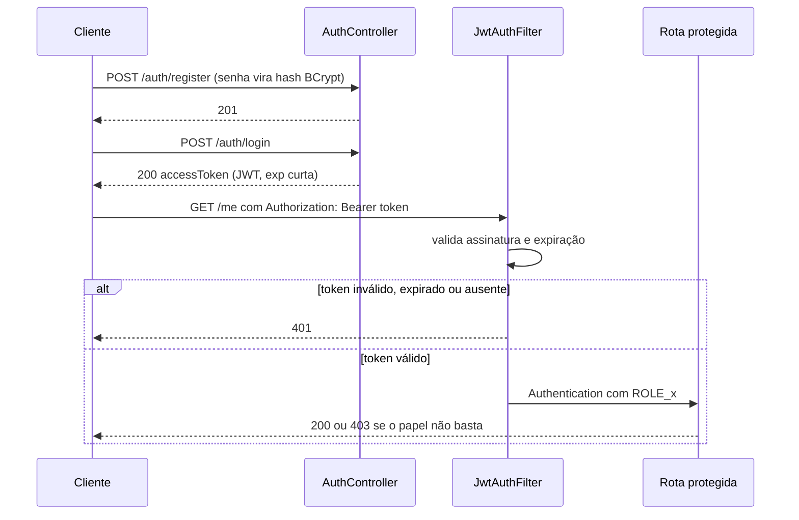

# auth-rbac-starter

Um ponto de partida para quem precisa de login com JWT e controle de acesso por papel num projeto Spring Boot. Tem registro, login, duas rotas protegidas (uma para usuários comuns, outra só para admin) e os testes que mostram que as regras estão funcionando de verdade.

## Por que eu fiz isso

Autenticação quase sempre aparece em vaga de Java júnior, e quase sempre é o ponto em que o código fica mais frágil. Quis montar algo pequeno, mas feito com cuidado: senha com BCrypt, token com expiração curta, chave fora do código e testes que tentam quebrar a segurança, não só testes do caminho feliz.

O escopo ficou enxuto de propósito. Refresh token, rate limit e OAuth2 ficam para depois (veja [Fora de escopo](#fora-de-escopo-nesta-versão)).

## Como funciona

O cliente se registra, faz login e recebe um token de acesso. Nas requisições seguintes, manda esse token no header `Authorization: Bearer ...`. O filtro valida a assinatura e a expiração; se estiver tudo certo, o Spring Security decide se o papel do usuário libera a rota.


Em forma de sequência:



## Arquitetura

Nada de mágica: são poucas camadas, cada uma com uma responsabilidade clara.


## Endpoints

| Método | Rota | Autenticação | Papel exigido | Sucesso | Erros |
|---|---|---|---|---|---|
| POST | `/auth/register` | Pública | Nenhum (sempre cria USER) | 201 | 409 |
| POST | `/auth/login` | Pública | Nenhum | 200 | 401 |
| GET | `/me` | Bearer JWT | USER | 200 | 401 / 403 |
| GET | `/admin/usuarios` | Bearer JWT | ADMIN | 200 | 401 / 403 |

Quem se registra sempre entra como USER. Um ADMIN só existe se for criado pela variável de ambiente de seed (veja abaixo).

## Configuração

Duas variáveis importam, e uma delas é obrigatória de propósito:

| Variável | Obrigatória | O que faz |
|---|---|---|
| `JWT_SECRET` | Sim | Chave que assina os tokens. Precisa ter pelo menos 32 caracteres. Não tem valor padrão: se faltar, a aplicação nem sobe. |
| `JWT_EXPIRATION_SECONDS` | Não | Validade do token, em segundos. Padrão: 900 (15 min). |
| `ADMIN_EMAIL` e `ADMIN_PASSWORD` | Não | Se as duas estiverem definidas, cria um ADMIN no startup. Sem isso, não existe admin. |

## Como rodar

Rodar os testes:

```bash
./mvnw verify
```

Subir a aplicação localmente (lembre de definir `JWT_SECRET`):

```bash
JWT_SECRET="troque-por-uma-chave-com-32-ou-mais-caracteres" ./mvnw spring-boot:run
```

Com Docker:

```bash
docker build -t auth-rbac-starter .
docker run --rm -p 8080:8080 -e JWT_SECRET="troque-por-uma-chave-com-32-ou-mais-caracteres" auth-rbac-starter
```

## Testes

Os testes estão em `AuthRbacTests`, com MockMvc. Os cenários que mais importam:

- `semTokenRetorna401`: sem token, a rota protegida responde 401.
- `userNaRotaAdminRetorna403`: USER tentando `/admin/usuarios` leva 403.
- `adminNaRotaAdminRetorna200`: ADMIN passa.
- `tokenExpiradoRetorna401`: token vencido é recusado.
- `tokenAdulteradoRetorna401`: token com payload mexido é recusado.
- `registerLoginMe`: o caminho completo, de cadastro até `/me`.

## Fora de escopo nesta versão

Ficou de fora de propósito, para manter o projeto enxuto: refresh token, rate limit com Bucket4j e OAuth2. São os próximos passos se o projeto crescer.

## O que eu faria diferente

- Trocaria o H2 em memória (com `ddl-auto: create-drop`, os dados somem a cada restart) por Postgres com Flyway.
- O `JwtAuthFilter` confia no papel que vem nas claims do token e não consulta o banco. Então um ADMIN rebaixado continua ADMIN até o token expirar.
- Não tenho refresh nem revogação: o único controle hoje é a expiração curta.
- Faltou um teste para a falha de startup sem `JWT_SECRET`.
- HS256 usa chave simétrica. Num cenário com vários serviços, eu consideraria uma chave assimétrica.
