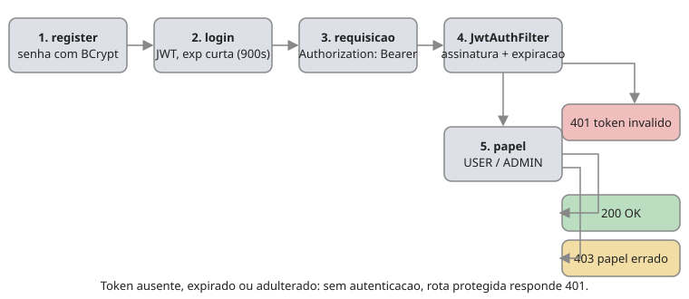
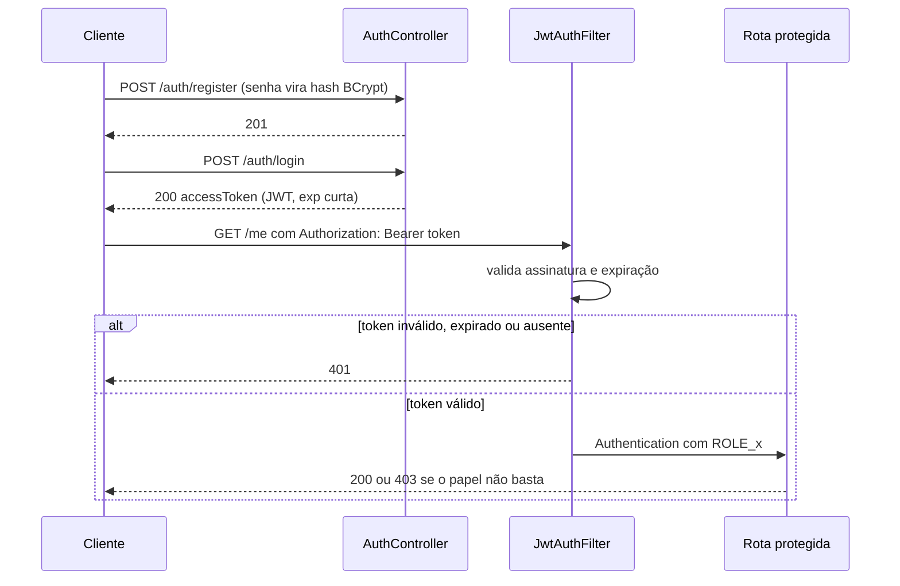
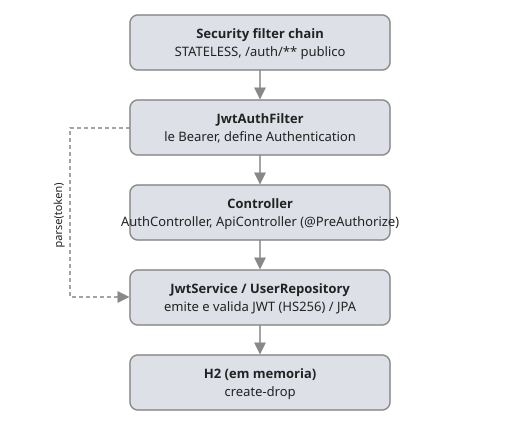

# auth-rbac-starter

API Spring Boot com registro, login e controle de acesso por papel (USER/ADMIN) usando JWT de acesso e Spring Security.

## Motivação

- **Portfólio para vaga de Dev Java júnior:** autenticação é uma lacuna comum; testes negativos de segurança mostram maturidade.
- **Escopo técnico do MVP:** login, JWT de acesso, RBAC e negação de acesso, com Spring Security 6, `@PreAuthorize`, MockMvc e testes 401/403.
- **Carreira:** Spring Security + JWT aparecem como exigidos às vezes em vagas Java júnior.

## Fluxo de autenticação





## Arquitetura



## Endpoints por papel

| Método | Rota | Autenticação | Papel exigido | Resposta de sucesso | Erros |
|---|---|---|---|---|---|
| POST | `/auth/register` | Pública | Nenhum (sempre cria USER) | 201 | 409 |
| POST | `/auth/login` | Pública | Nenhum | 200 | 401 |
| GET | `/me` | Bearer JWT | USER | 200 | 401/403 |
| GET | `/admin/usuarios` | Bearer JWT | ADMIN | 200 | 401/403 |

`/me` exige `hasRole("USER")` em `SecurityConfig`; um token sem o papel USER recebe 403.

## Configuração

| Variável | Obrigatória | Descrição |
|---|---|---|
| `JWT_SECRET` | Sim | Chave de assinatura, mínimo 32 caracteres. Sem valor padrão: a aplicação não sobe sem ela. |
| `JWT_EXPIRATION_SECONDS` | Não | Validade do token em segundos. Padrão: 900. |
| `ADMIN_EMAIL` e `ADMIN_PASSWORD` | Não | Se ambas definidas, cria um ADMIN no startup (seed). |

## Como rodar

Testes:

```bash
./mvnw verify
```

Aplicação local (defina `JWT_SECRET` antes):

```bash
JWT_SECRET="troque-por-uma-chave-com-32-ou-mais-caracteres" ./mvnw spring-boot:run
```

Imagem Docker:

```bash
docker build -t auth-rbac-starter .
```

Container:

```bash
docker run --rm -p 8080:8080 -e JWT_SECRET="troque-por-uma-chave-com-32-ou-mais-caracteres" auth-rbac-starter
```

## Testes

Em `AuthRbacTests` (MockMvc):

- `semTokenRetorna401`: sem token, rota protegida retorna 401.
- `userNaRotaAdminRetorna403`: USER em `/admin/usuarios` retorna 403.
- `adminNaRotaAdminRetorna200`: ADMIN em `/admin/usuarios` retorna 200.
- `tokenExpiradoRetorna401`: token expirado é rejeitado.
- `tokenAdulteradoRetorna401`: token adulterado é rejeitado.
- `registerLoginMe`: fluxo completo register, login e `/me`.

## Fora de escopo nesta versão

Evolução futura: refresh token, rate limit (Bucket4j) e OAuth2.

## O que faria diferente

- Trocar o H2 em memória (`ddl-auto: create-drop`, dados somem a cada restart) por Postgres com Flyway.
- O `JwtAuthFilter` confia nas claims do token (incluindo o papel) sem consultar o banco: um ADMIN rebaixado continua ADMIN até o token expirar.
- Não há refresh nem revogação de token; o único controle é a expiração curta.
- Não há teste de falha de startup sem `JWT_SECRET`.
- HS256 usa chave simétrica; em cenário multi-serviço, considerar chave assimétrica.
